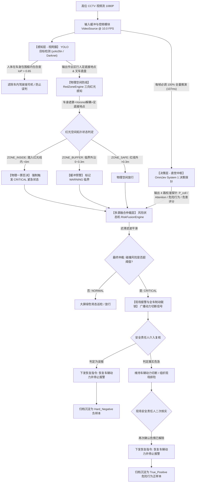

2:## 基于高位 CCTV 监控、三向红光物理防线与双系统认知模型 (YOLO + OmniJev) 的工业人车安全预警系统
## 基于高位 CCTV 监控、三向红光物理防线与双系统认知模型 (YOLO + OmniJev 全频推演) 的工业人车安全预警与联锁控制系统

---

## 1. 项目概述与技术背景 (Overview & Background)

### 1.1 业务背景与工业安全挑战

在现代化工业制造车间、智慧仓储及大型物流中心，工业叉车与行人的交叉作业高度频繁。人车混行导致的挤压、碰撞事故在恶性工业工伤事故中占比长期高居不下。

当前厂区安全治理面临三大核心痛点：
1. **“人工盯监控”的生理与规模极限（核心痛点）**：传统厂区安全完全依赖保安或值班人员“肉眼盯大屏”。随着工厂与仓储规模不断扩大、高位摄像头成百上千，人类监控人员需要面对几十上百路画面轮播。受人类生理疲劳、注意力盲区与偶发走神影响，安保人员根本无法在长达数小时的海量正常画面中，及时捕捉那仅发生于数秒之内的突发人车碰撞瞬间，漏看漏判率极高；
2. **事后追溯为主，缺乏事中即时干预**：传统安防系统更多是事故发生后的“录像回放与定责工具”，无法在危险发生前的黄金几秒内主动报警干预；
3. **传统规则误报高，导致警报疲劳**：传统基于简单像素距离或移动边界的检测算法，在面对俯视透视畸变、远近遮挡或人员正常并排行走时极易产生“误报风暴”。频繁虚警使现场管理人员逐渐麻木，安全防线形同虚设。
---

### 1.2 核心技术路线动因：为什么采用高位 CCTV 与 System 1 决策模型？

Intelli-Shield 确立了**“厂区高位 CCTV 俯视感知 + System 1 多模态快决策中枢”**的技术路线：

1. **场景选择：为什么采用固定高位 CCTV 摄像头？**
   * **零改装与极低落地成本**：在动辄成百上千台叉车的工业现场，无需对每台车辆进行昂贵的车载激光器、传感器或工控机硬件改装；直接复用厂区既有立柱与墙面高位监控摄像头，实现零硬件改造成本；
   * **全局视野无颠簸畸变**：高位固定俯视角度（30°~60°俯角）能够覆盖全通道、十字路口与作业拐角，视野无阻挡且画面平稳，避免了车载镜头剧烈晃动、镜头遮挡及视角受限问题。

2. **算法升级：为什么采用 System 1 决策模型而非生成式大模型或单一规则？**
   * **否定传统纯几何规则**：单一像素距离无法识别人车动态意图（如“背对低头分心” vs “主动驻足避让”），在透视画面下极难设置泛化阈值；
   * **否定慢速自回归生成大模型（System 2）**：当前开源多模态大模型（GLM-4.6V-Flash / Qwen3-VL / InternVL-U 等 SOTA VLM）虽然具备极强的视觉常识理解能力，但其决策必须经由自回归逐 Token 生成自然语言描述，单帧单问需 1.5~4 秒，且输出为自由文本、需额外正则/JSON 解析才能驱动工控逻辑，格式不可控且严重超时，根本无法适应工业秒级报警；
   * **确立 OmniJev 每帧全频推演 (System 1 快决策)**：引入认知科学中的“直觉快思考”理念，彻底摒弃为省算力而跳过推演的妥协做法。视频源按 **10.0 FPS** 控频，与 OneJev-0.8B 在 RTX 3090 上的单次前向推理时延（**107ms**）严格 1:1 节拍咬合。每帧直接输出校准后的碰撞概率、工人注意力分布、工人危险行为（如低头玩手机、背对叉车）以及四级危险评分，兼具视觉大模型的常识理解力与工控级的毫秒级响应速度。

3. **空间防线升级：为什么必须感知地表三向红光防撞警戒线（Red-Zone Perimeter）？**
   * **工业现实标准**：现代仓储叉车普遍配备工业级三向（左侧、右侧、后方）一字红光投影灯，在地面形成半封闭 U 型物理禁行区（距离车体约 1.5~2m），工人进入红光以内即属于严重违章；
   * **破解透视畸变与静止对消盲区**：高位 CCTV 俯角下，使用人体 BBox 中心点算欧式距离不仅产生严重透视投射错位，且若叉车在工人旁微停（例如铲货对齐），传统静止对消机制会将红光内的侵入工人误判为 NORMAL；
   * **确立分层仲裁原则**：将地表三向红光确立为**物理安全底线（Floor Hard Constraint）**，以行人**双脚地面接地点**做拓扑判别，红光侵入具备**一票否决权**强制直出 `CRITICAL`；同时由 **OmniJev 认知探针赋予语义与上下文（Context Attribution）**，形成“硬防线保底 + 软感知定性”的闭环。

### 1.3 产品形态定位与核心价值

* **产品形态**：纯软件服务系统（Pure Software-as-a-Service / Local Server Pipeline）；
* **产品定位**：连接厂区高位监控视频流，集“几何目标检测、多模态语义决策、多源风险仲裁、态势大屏可视化、安全责任人复核确认”于一体的工业人车安全主动预警与留痕中枢；
* **核心工作流与价值主张（机器毫秒预警制动 + 责任人两段式闭环确认 + 样本回流）**：
  * **机器及时发现、现场报警并制动全车**：系统 7×24 小时不间断以 10 FPS（100ms 步长）逐帧巡检，一旦判定碰撞风险超过阈值，立即触发现场声光警报，并向画面内所有在编叉车广播动力切断与制动联锁信令；
  * **责任人两段式复核确认（误报即时恢复 vs 危急二次确认）**：系统报警制动后立即向现场安全责任人推送告警凭证与多维探针数据。若判定误报，一键恢复车辆动力并停报；若判定属实危急，维持制动并组织现场排险，排险完毕后二次确认危情解除方可恢复动力，落实安全生产责任制；
  * **人在回路样本回流沉淀（支持后续微调与联邦学习）**：责任人的人工核验结果（属实危急 / 误报）全量结构化归档为多模态样本对，持续反哺专用检测模型与 OmniJev 的对齐微调；未来亦可作为各厂区“数据不出厂”的联邦微调（Federated Fine-Tuning）本地标注源。
---
### 1.4 目标用户角色与核心场景

* **目标用户**：
  * **生产安全总监 / 现场安全责任人**：系统报警的第一响应人，负责在大屏或移动端查看报警快照，**复核确认 OmniJev 决策结果是否属实**，确认后立即执行现场对讲喊话干预，并闭环记录隐患台账；
  * **现场作业调度员**：关注大屏实时态势、叉车通道流向与高风险通道动态，协调人车分流通行；
  * **系统运维与开发人员**：关注算法服务可用性、推理时延指标与人工复核反馈数据归档。
* **核心覆盖场景**：
  * 主通道与支通道十字交叉盲区交汇口；
  * 仓储货架通道出入口；
  * 物料装卸月台与高频叉车作业交织区。

---

## 2. 系统总体架构与数据流 (Architecture & Dataflow)

### 2.1 双系统认知与物理防线分层架构 (Layered Dual-Process Architecture)

Intelli-Shield 2.0 确立了**“物理硬约束保底线（Floor） + 认知软探针赋语义（Context）”**的分层架构：



1. **感知层（System 1 前哨 - 视网膜）**：
   * **定位**：高帧率几何定位与空间特征提取。
   * **技术选型**：Ultralytics YOLO26 Nano / 导师实景权重 YOLOv4 Darknet。
   * **核心职责**：在本地 CPU/工控机上稳定运行，提取行人与工业特种车辆（`forkTruck`, `truck`）空间包围框。

2. **物理防线层（Floor Baseline - 地表红光拓扑感知）**：
   * **定位**：地表三向红光激光防线提取与足底接地锚点拓扑判定。
   * **核心职责**：利用色彩空间（$R>165, R-B>65, R-G>35$）与 Voronoi 车底最近邻聚类，构建叉车四周地面封闭禁区多边形；以行人底边中点 $(x_{\text{mid}}, y_2)$ 判定相对红线的有符号距离，划分 `ZONE_INSIDE`、`ZONE_BUFFER`（$0\sim 0.30\text{m}$）与 `ZONE_SAFE`。

3. **决策层（System 1 核心 - 直觉反应中枢）**：
   * **定位**：毫秒级多模态常识理解、全帧满频认知与确定性概率输出。
   * **技术选型**：OneJev-0.8B（TypeSafe AI 零生成 Token 前向推理运行时）。
   * **核心职责**：在零生成 Token 开销下逐帧并行计算 4 路决策探针（碰撞概率、工人注意力分布、工人危险行为辨识、四级危害严重度），为物理越界补充高价值行为归因（如低头玩手机、背对叉车），并在红线外提前预判高速倒车碰撞轨迹。

4. **融合仲裁与联锁控制层（Arbitration & Interlock Engine）**：
   * **定位**：分层准则仲裁、一票否决、动力切断联锁下发与两段式安全处置状态机。

### 2.1.1 核心模块架构分工与协同关系 (YOLO vs 红光物理防线 vs OmniJev)

引入地表红光多边形判定后，系统不仅没有削弱 YOLO，反而使其回归至最核心的「物理视网膜」基准定位。三大核心模块的分工协同关系如下：

| 模块名称 | 形象比喻 | 系统定位 | 核心工程职责 | 回答的核心问题 |
| :--- | :--- | :--- | :--- | :--- |
| **YOLO** | **感知视网膜 (Retina)** | 感知前哨 / 空间锚点 | 1. 识别行人并提取底边中点 $(x_{\text{foot}}, y_{\text{foot}})$ 作为足底真实接地点；<br>2. 识别叉车并屏蔽上部 $78\%$ 车身（避免车身红漆与尾灯干扰地表光带）；<br>3. 多车同框时提供 Voronoi 聚类中心，防止跨车光斑粘连；<br>4. 执行车内司机排除（IoP 包含度计算），避免司机坐车内导致 100% 误报死锁。 | **“画面中有谁？人在哪？车在哪？”<br>(What & Where)** |
| **RedZoneEngine** | **物理红光防线 (Floor)** | 空间硬约束 / 底线防御 | 1. 提取地表左/右/后三向高亮激光光斑并拟合封闭禁区多边形；<br>2. 以足底锚点执行点线面拓扑判定（`pointPolygonTest`）；<br>3. 建立 $0\sim 0.30\text{m}$ 自适应物理缓冲带；<br>4. 踩入红线（`ZONE_INSIDE`）实施**一票否决权**强制直出 `CRITICAL`（不受静止车辆对消限制）。 | **“人有没有踩进法定禁区？”<br>(Physical Boundary)** |
| **OmniJev** | **直觉大脑 (System 1)** | 认知决策 / 语义定性 / 危险行为量化 | 1. 107ms 单前向推理输出 4 路校准探针（碰撞概率、注意力分布、危险行为、4 级危害评分）；<br>2. 识别工人危险行为（低头看手机、背对驶来叉车、盲区滞留）；<br>3. 为物理越界事故赋予高价值管理归因（如“背对叉车且低头玩手机，注意力缺失”）；<br>4. 在红线外安全区（`ZONE_SAFE`）提前预判高速交汇轨迹，驱动主动联锁预警。 | **“人有没有危险行为？车会不会撞上去？”<br>(Context, Behavior & Intention)** |
**三者不可替代性与系统反脆弱设计**：
* **若没有 YOLO**：红光算法本身缺失语义识别，无法提取足底触地点；无法遮罩车身红漆；无法排除车内司机，导致只要有人开车就 100% 报警死锁；
* **若没有 RedZone**：仅凭 YOLO 框中心算欧氏距离，无法感知地面物理红线，高位俯视角透视畸变严重，且叉车铲货微停时会被静止对消误判为 NORMAL 导致致命漏报；
* **若没有 OmniJev**：系统退化为冷冰冰的机械踩线蜂鸣器，无法识别人类注意力意图，无法为安全责任人提供语义解释，无法在红线外实现提前预测性阻断。
---

### 2.2 逻辑分层与数据流时序 (Sequence Dataflow)

系统按 10 FPS 控频摄取高位视频，端到端执行全帧满频认知与联锁控制：

```text
[CCTV Stream]   [VideoSource@10FPS]   [YOLO+PreSanitize]   [OmniJev(4Probes)]   [RiskFusion]      [Web Front]     [Forklift Fleet]
      │                  │                   │                   │                   │               │               │
      │── 1080P原始帧 ──>│                   │                   │                   │               │               │
      │                  │── 10FPS恒频BGR ──>│                   │                   │               │               │
      │                  │                   │── 目标/足底接地 ─>│                   │               │               │
      │                  │                   │   (排除车内司机)  │                   │               │               │
      │                  │                   │                   │                   │               │               │
      │                  │── 每帧无条件派发 ────────────────────>│                   │               │               │
      │                  │                   │                   │── 107ms单前向 ────│               │               │
      │                  │                   │                   │   (4路并行探针)   │               │               │
      │                  │                   │                   │<─ 校准分布/行为 ──│               │               │
      │                  │                   │                   │                   │               │               │
      │                  │                   │── Perception ────────────────────────>│               │               │
      │                  │                   │                   └── Probes ────────>│               │               │
      │                  │                   │                                       │── 风险状态机 ─>│               │
      │                  │                   │                                       │               │               │
      │                  │                   │   [若判定碰撞风险超标 (CRITICAL)]      │── FrameDec WS>│               │
      │                  │                   │                                       │── 广播声光 ──>│ [现场声光警报] │
      │                  │                   │                                       │── MQTT动力切断 ───────────────>│ [全车动力切断]
      │                  │                   │                                       │               │               │
      │                  │                   │   [责任人两段式介入: 误报即时恢复 / 属实二次确认解除]  │<─ 恢复/停报 ──>│ [恢复动力行车]
```

---

### 2.3 软硬件物理部署拓扑 (Deployment Topology)

```text
┌───────────────────────────────────────────────┐
│  边缘处理 / 流水线客户端节点 (Local Client Node) │
│  - 硬件建议: 工控机 / 本地工作站 (多核 CPU)    │
│  - 模块:                                      │
│    • VideoSource (RTSP / 本地视频取流)        │
│    • YOLODetector (yolo26n 纯 CPU 毫秒推理)   │
│    • RiskFusionEngine (仲裁引擎)              │
│    • Web Gateway (FastAPI + WebSocket 推送)  │
└───────────────────────┬───────────────────────┘
                        │
                        │ 1. 内网 HTTP API (POST /probe) 每帧 10FPS 派发
                        │ 2. 工业 MQTT 总线 (factory/forklift/+/control/power_cutoff)
                        ▼
┌───────────────────────────────────────────────┐
│  高性能决策算力中心 (Inference Host / 3090)    │
│  - 硬件环境: NVIDIA RTX 3090 (24GB VRAM)      │
│  - 软件底座: qev-0.1.1 决策服务运行时          │
│  - 加载模型: OneJev-0.8B (FP16 / CUDA Graph) │
│  - 执行模式: 107ms 单前向 4 探针全帧推演      │
│    • 探针 1: collision_risk (Noul: [0.0, 1.0])│
│    • 探针 2: worker_awareness (Choice 3类)   │
│    • 探针 3: worker_hazard_behavior (Choice)  │
│    • 探针 4: threat_score (Score 0~3 期望值)  │
└───────────────────────────────────────────────┘

---

### 2.4 容灾降级与双轨运行策略 (Failover & Dual-Mode)

1. **在线服务异常自动降级（Failover to Geometric Rule）**：
   * 当 3090 决策算力节点网络抖动、GPU 任务排队或响应时延超过超时阈值（默认 800ms）时，系统自动降级：
   * `probes` 字段填入 `null`，仲裁引擎自动回退至“纯几何空间距离与外扩包围圈”规则模式，保障基础防碰撞报警永不宕机。
2. **离线批处理与无网现场保底（Batch Replay Mode）**：
   * 针对学校实验室、展会或客户现场无 GPU 算力机的演示工况，系统原生支持 `--replay <results.json>` 模式。
   * 流水线将预先在 3090 上跑完的真实探针结果与视频流毫秒级时间戳对齐，驱动大屏展示，保证现场演示 100% 稳定可复现。

---

## 3. 感知-决策双系统功能规范 (Perception & Decision Specs)

### 3.1 感知层规范 (Perception Layer - YOLO & Red-Zone Engine)

#### 3.1.1 目标检测与前哨清洗规范 (YOLO & Pre-Perception Sanitizer)
1. **模型与输入规格**：
   * 支持双模型架构：
     * 主线方案：导师实测 Darknet YOLOv4 工业定制权重（`yolov4-custom-hebei_last.weights`，14 类目标检测，准确区分 `forkTruck` 与大货车 `truckHead`/`truck`）；
     * 轻量升级方案：Ultralytics `yolo26n.pt`（端到端 NMS-Free 单步推理，CPU 耗时约 108ms）。
   * 输入源：CCTV 监控图像（RGB/BGR 格式，原生 1080P 或 $608\times 608$ 动态尺度）。
   * **驾驶座司机前哨清洗 (Pre-Perception Sanitizer)**：
     * 计算人体包围框与叉车包围框的交并包含度（$\text{IoP} = \frac{\text{Area}(\text{Ped} \cap \text{Forklift})}{\text{Area}(\text{Ped})}$）；
     * 当 $\text{IoP} \ge 0.65$ 且人体中心位于叉车上部驾驶室范围时，自动标记为“在编司机”，排除在受威胁行人列表之外，杜绝司机自身导致 100% 误报死锁。

2. **类别识别与置信度过滤**：
   * 目标类别过滤：严格提取行人（`person`）与工业叉车（`forkTruck`）；大货车（`truck`）独立标识，不参与叉车激光线聚类；
   * 置信度过滤阈值：默认 `0.25`，NMS 抑制阈值 `0.40`。
#### 3.1.2 地表三向红光激光防线感知规范 (Optical Red-Zone Engine)
1. **工业红光特征提取与车身遮罩 (Laser Strip Extraction)**：
   * 针对叉车搭载的高亮度一字红光投影灯，在颜色空间提取强红光掩膜：$R > 165$ 且 $(R - B) > 65$ 且 $(R - G) > 35$；
   * **车身油漆动态遮罩**：自动屏蔽每台叉车包围框上部 $78\%$ 区域，防止叉车车身橙红色金属外壳、安全护顶架及尾灯被误识别为地表激光光斑，仅保留接地轮胎轮廓周边的纯地面激光条。

2. **Voronoi 车底最近邻聚类与多边形构建 (Per-Forklift Polygon Assignment)**：
   * 多车同框时，通过连通域分析提取各段地面光带，按照到叉车底盘接地框（$[x_1, x_2] \times [y_1 + 0.65h, y_2]$）的欧氏最近邻距离，动态聚类归属至对应叉车；
   * 聚类距离上限设为车辆物理尺寸的 1.15 倍（$1.15 \times \max(w, h)$），彻底杜绝跨车光斑误粘连；
   * 结合车辆底盘接触点与三向激光光带坐标，通过 `cv2.convexHull` 构建贴合地面的封闭危险禁区多边形（`RedZonePolygon`）；若光照过暗缺失激光，启用 $1.5\text{ m}$ 物理基准包络框作为退化保底。

3. **人体足底接地锚点与空间分类 (Foot Ground-Anchor Topology)**：
   * 摒弃人体中心点，取行人 BBox 底边中点 $(x_{\text{foot}}, y_{\text{foot}}) = (\frac{x_1 + x_2}{2}, y_2)$ 作为真实的地面接地点，彻底消除俯角监控透视畸变；
   * 采用 `cv2.pointPolygonTest` 计算足底锚点到红光禁区多边形边缘的有符号几何距离 $d$（内侧为负，外侧为正）：
     * **`ZONE_INSIDE` ($d < 0\text{ m}$)**：双脚已越过红光线踩入禁区 $\rightarrow$ **物理一票否决，直接定性为 `CRITICAL` 严重违规**；
     * **`ZONE_BUFFER` ($0 \le d \le 0.30\text{ m}$)**：足底距红光外沿不足 $0.3\text{米}$（像元自适应阈值 $\text{buffer\_px} = H_{\text{ped}} \times \frac{0.28}{1.75} \approx 18\sim 26\text{ px}$） $\rightarrow$ **定性为 `WARNING` 临界预警**；
     * **`ZONE_SAFE` ($d > 0.30\text{ m}$)**：人员完全处于红光安全线外 $\rightarrow$ 放行物理硬约束，进入 OmniJev 意图预测通道。

---

### 3.2 决策层规范 (Decision Layer - OmniJev System 1)

1. **每帧全频推演机制 (Per-Frame Continuous Inference Policy)**：
   * **彻底废除算力跳过与休眠**：不再为了节省算力而执行门控拦截（摒弃 Fast-Path NORMAL），每帧画面均无条件派发至 3090 算力节点；
   * **10.0 FPS 恒频对齐**：视频摄取控频固定为 **10.0 FPS**（100ms 单帧步长），与 OneJev-0.8B 在 RTX 3090 上的单次前向时延（**107.0ms ~ 110.0ms**）严格 1:1 咬合，彻底避免任务积压或丢帧抖动。

2. **四路决策探针 Schema (Four Decision Probes Schema)**：
   * **探针 1：`collision_risk` (`Noul` 探针 - 二值校准概率)**：
     * 评定提示词：`In this industrial CCTV camera view, is any forklift in dangerous proximity or on an active collision trajectory with a pedestrian?`
     * 输出规格：Float $\in [0.0, 1.0]$，评定人车即刻轨迹碰撞风险。
   * **探针 2：`worker_awareness` (`Choice` 探针 - 注意力意图分布)**：
     * 评定提示词：`What is the primary attention state of workers near active machinery in this scene?`
     * 离散选项字典：`unaware`（分心/无戒备）、`yielding`（注视避让中）、`separated`（处于人行物理隔离区）。
   * **探针 3：`worker_hazard_behavior` (`Choice` 探针 - 工人危险违章行为)**：
     * 评定提示词：`Does any worker exhibit dangerous non-compliant behaviors near forklifts, such as looking down at phone or walking with back turned?`
     * 离散选项字典：
       * `phone_distracted`：低头看手机 / 违规分心操作；
       * `back_facing_vehicle`：背对开过来的叉车 / 盲区反向行走；
       * `standing_in_blindspot`：盲区违规长时间驻留；
       * `normal_compliant`：合规作业 / 保持安全观察。
   * **探针 4：`threat_score` (`Score` 探针 - 综合危害严重度)**：
     * 评定提示词：`Rate the overall collision hazard severity of this operational zone from 0 (safe clearance) to 3 (imminent critical impact).`
     * 参数：`levels = 4`；
     * **底层数学原理**：基于 `levels=4` 计算 4 个有序等级（$k \in \{0, 1, 2, 3\}$）的 Softmax 概率分布后求数学期望值：
       $$\text{threat\_score} = \mathbb{E}[\text{level}] = \sum_{k=0}^{3} k \cdot P(\text{level} = k) \in [0.0, 3.0]$$
     * **四级工业危害烈度分级标准与前端色彩映射表**：

| 危害等级 | 数值区间 | 工业安全状态定义 (OSHA / GB/T 2893 对齐) | 前端 UI 标识色彩 | 系统联锁与响应动作 |
| :--- | :--- | :--- | :--- | :--- |
| **Level 0** | $0.00 \sim 0.49$ | **正常受控 (Safe Clearance)**<br>人车安全隔离，无碰撞干涉轨迹 | 翠绿色 (`#10B981`) | 绿灯常亮，系统常态巡检放行 |
| **Level 1** | $0.50 \sim 1.49$ | **低度注意 (Cautionary)**<br>人车处于同一直线作业区，存在一般逼近 | 高空蓝 (`#38BDF8`) | 蓝灯提示，大屏标记关注通道 |
| **Level 2** | $1.50 \sim 2.19$ | **临界预警 (Warning Alert)**<br>轨迹交汇逼近或工人出现低头分心违章 | 琥珀黄 (`#F59E0B`) | 黄灯闪烁，大屏弹出预警卡片 |
| **Level 3** | $2.20 \sim 3.00$ | **严重危急 (Critical Danger)**<br>濒临碰撞冲击或足底越过地表红光线 | 朱红色 (`#EF4444`) | **红灯爆闪，现场报警，切断全车动力** |

3. **推理时延 SLA 与断路器规范**：
   * 在 RTX 3090 上稳态前向推理耗时保证在 **107.0ms ~ 110.0ms**（零生成 Token）；
   * 超时断路器：客户端等待超时限制为 **800ms**，超时立即中断并安全降级。
### 3.3 分层风险融合仲裁引擎 (Layered Risk Fusion Engine)

#### 3.3.1 分层仲裁决策矩阵与联锁控制逻辑 (Layered Decision Matrix & Interlock Logic)

| 层级 | 判定条件 | OmniJev 探针上下文 (注意力 / 危险行为) | 最终仲裁等级 | 告警定性与现场系统联动 |
| :--- | :--- | :--- | :--- | :--- |
| **Layer 1 (物理硬约束)** | **`ZONE_INSIDE`** (足底进入红光线内 $<0\text{m}$) | 归因上下文：`back_facing_vehicle` 或 `phone_distracted` $\ge 0.50$ | **`CRITICAL` (极度危急)** | **【严重违章/物理侵入】** 一票否决。**现场声光报警鸣响，广播切断画面内所有叉车动力 (Fleet Cutoff)** |
| **Layer 1 (物理硬约束)** | **`ZONE_INSIDE`** (足底进入红光线内 $<0\text{m}$) | 归因上下文：`normal_compliant` 或探针未就绪 | **`CRITICAL` (物理越界)** | **【物理红区侵入违规】** 一票否决。**现场声光报警鸣响，广播切断画面内所有叉车动力 (Fleet Cutoff)** |
| **Layer 1 (物理硬约束)** | **`ZONE_BUFFER`** (足底距红光外沿 $0\sim 0.3\text{m}$) | 碰撞风险 $P_{\text{coll}} \ge 0.70$ 或危害度 $\ge 2.20$ | **`CRITICAL` (临界高危)** | **【红线临界+碰撞轨迹】** 升格为 CRITICAL。**现场报警，广播切断画面内所有叉车动力** |
| **Layer 1 (物理硬约束)** | **`ZONE_BUFFER`** (足底距红光外沿 $0\sim 0.3\text{m}$) | 碰撞风险 $P_{\text{coll}} < 0.70$ 且危害度 $< 2.20$ | **`WARNING` (预警关注)** | **【红光外沿缓冲预警】** 提示作业人员保持 $0.3\text{m}$ 以上安全间距，保持动力，大屏黄灯 |
| **Layer 2 (前瞻预测)** | **`ZONE_SAFE`** (红光线外 $>0.3\text{m}$) | 碰撞风险 $P_{\text{coll}} \ge 0.70$ 或危害度 $\ge 2.20$ | **`CRITICAL` (前瞻阻断)** | **【前瞻碰撞告警】** 红线外高速交汇盲区。**现场报警，广播切断画面内所有叉车动力** |
| **Layer 2 (前瞻预测)** | **`ZONE_SAFE`** (红光线外 $>0.3\text{m}$) | 碰撞风险 $P_{\text{coll}} < 0.40$ | **`NORMAL` (安全受控)** | 人车安全隔离，系统正常巡检放行，绿灯常亮 |

> 💡 **危险行为探针的角色定位**：`worker_hazard_behavior` 探针（如低头看手机、背对开来的叉车）作为**核心管理定性与事故归因上下文**，向责任人直观揭示事故隐患成因，并作为高价值训练标签沉淀；现场制动与报警的触发条件严格锚定于“碰撞风险超过阈值”或“踩入物理红光禁区”，杜绝脱离轨迹干涉的单独越权乱制动。

#### 3.3.2 防抖与时域迟滞回差机制 (Temporal Hysteresis)
* **触发防抖 (Trigger Threshold)**：连续 **2 帧** 检测到侵入红光禁区（`ZONE_INSIDE`）或触发条件，状态机正式跃迁至 `CRITICAL`（首帧直接初始化防漏报）；
* **恢复迟滞 (Release Hysteresis)**：处于报警状态时，必须连续 **4 帧** 稳定处于 `ZONE_SAFE`（红光外 $>0.3\text{m}$），状态才允许平滑降级回 `NORMAL`，杜绝工业现场高频频闪。

## 4. Web 态势感知大屏功能规范 (Dashboard UI Specs)

大屏基于既有 Vue 3 / Vite 工业深色主题构建，作为系统唯一的可视化人机交互窗口，布局划分为“左侧/中央视频 HUD 视窗”、“右上决策探针雷达”、“右下时序风险心电图”与“底部/侧边告警事件抽屉”。

### 4.1 实时监控 HUD 动态图层 (Live Video HUD)

1. **基础视窗与流媒体兼容**：
   * 保持 16:9 标准工业视窗比例，支持主流流媒体（RTSP 转 WebRTC / MJPEG）以及本地 CCTV 循环测试视频源播放；
   * 画面上方叠加半透明玻璃拟态（Glassmorphism）图层，用于矢量标绘，不得引起视频卡顿。

2. **动态目标框与地表红光图层（SVG Overlay）渲染规范**：
   * **地表三向红光安全禁区多边形 (`scaledRedZonePolygons`)**：
     * 在视频画面地面动态渲染叉车四周投影的封闭警戒多边形；
     * 配色规范：`CRITICAL` 下填充半透明暗红（`rgba(239, 68, 68, 0.24)`）配合高亮红色虚线边框；`WARNING` 下填充琥珀黄；`NORMAL` 下填充低饱和度安全绿；
   * **行人目标与足底接地瞄准准星 (`scaledFootAnchors`)**：
     * 行人身体框顶部标注 `Person [Conf]`；
     * 在工人双脚触地位置绘制动态准星靶心（双层同心圆与四向十字准心线）；
     * 准星下方挂载动态距离标牌：
       * 侵入红线时：`🚨 足底越过红线: -0.96m`（红色高亮闪烁）；
       * 临界逼近时：`⚠️ 0~0.3m缓冲带: +0.18m`（琥珀黄）；
       * 处于安全区：`✔ 足底锚点: 红光外 +2.27m`（翠绿）；
   * **叉车目标框与动力切断联锁标牌**：标注 `【叉车】三向红光警戒区 [Conf]`；当系统判定触发 `CRITICAL` 时，框顶追加高亮爆闪角标 `🛑 [全车动力切断 / 联锁制动中]`，与地面禁区红光及现场电控联动呼应。
3. **全局风险等级指示浮标 (Risk Status Badge)**：
   * 视窗顶部水印区常驻状态指示胶囊：
     * `NORMAL`：常亮墨绿，显示“✔ 红光安全线外 · 正常通行 (NORMAL)”；
     * `WARNING`：亮黄微动，显示“▲ 红光0~0.3m缓冲预警 (WARNING)”；
     * `CRITICAL`：高亮朱红爆闪，显示“● 红光禁区侵入 · 紧急阻断 (CRITICAL)”。

4. **浮动认知探针与物理防线胶囊 (Telemetry Capsule)**：
   * 视窗左下角设立双系统状态胶囊：
     * 字段 1：`双系统认知直觉推演: OneJev-0.8B + 红光围栏`；
     * 字段 2：`三向红光物理边界: 侵入红线 -0.96m (违章)` 或 `安全线外 +2.27m`；
     * 字段 3：`碰撞风险概率: P(collision)` 实时百分比；
     * 字段 4：`综合危害烈度: Threat Score / 3.0`。
---

### 4.2 OmniJev 决策探针状态雷达 (System 1 Decision Radar)

用于向安防主管及导师直观展示大模型毫秒级 System 1 输出，包含三个子组件：

1. **碰撞风险半环形仪表盘 (Collision Risk Gauge)**：
   * 刻度范围：$0\% \sim 100\%$，指针根据 $P_{\text{coll}}$ 实测值平滑过渡；
   * 分段配色：$0\% \sim 40\%$ 为安全绿区，$40\% \sim 70\%$ 为预警黄区，$\ge 70\%$ 为危险红区；
   * 中心显眼标注当前实时概率数值（如 `P(coll) = 88.5%`）。

2. **工人注意力分布横向堆叠条 (Worker Attention Breakdown)**：
   * 采用三色百分比横向堆叠进度条，动态反映 Choice 探针分布：
     * 红色段：`unaware`（分心/背对/看手机）；
     * 黄色段：`yielding`（注视避让中）；
     * 绿色段：`separated`（处于人行物理安全通道）；
   * 右侧以动态标签高亮显示当前占主导地位的状态。

3. **四级危害烈度评分卡 (Threat Severity Card - 四色分级指示)**：
   * 展示 Score 探针期望得分（$0.0 \sim 3.0$）；
   * 底部配套 **4 级阶梯指示灯与工业安全色标**，随实时评分自动点亮对应色阶：
     * **Level 0 (0.00 ~ 0.49)**：翡翠绿灯高亮 (`#10B981`)，标牌显示 `【Level 0 正常受控】`；
     * **Level 1 (0.50 ~ 1.49)**：高空蓝灯高亮 (`#38BDF8`)，标牌显示 `【Level 1 轻度注意】`；
     * **Level 2 (1.50 ~ 2.19)**：琥珀黄灯高亮 (`#F59E0B`)，标牌显示 `【Level 2 临界预警】`；
     * **Level 3 (2.20 ~ 3.00)**：朱红爆闪高亮 (`#EF4444`)，标牌显示 `【Level 3 紧迫危险 - 动力切断】`。

4. **工人危险行为辨识卡 (Hazardous Behavior Capsule)**：
   * 动态显示 Choice 探针中占主导地位的行为选项并挂载置信概率：
     * 若检测到分心：显示红色高危标签 `🚨 [严重违章] 低头看手机 (78%)` 或 `🚨 [视线盲区] 背对开来叉车 (82%)`；
     * 若未检测到违规：显示低饱和绿色标签 `✔ 规范作业中 / 保持环境观察`；
   * 该定性标签直接同步投递至右侧待办告警抽屉，作为安全责任人定性复核的核心凭据。
---

### 4.3 毫秒级时序风险走势图与红光防线通道 (Real-Time Risk & Red-Zone Timeline)

1. **双轴折线与关键特征点**：
   * 横轴：30 秒连续监控序列（对应 752 帧实况）；
   * 纵轴：标准化 $[0.0, 1.0]$ 区间，绘制 $P_{\text{coll}}$ 碰撞概率动态波形与威胁烈度辅助曲线；
   * 标注阈值辅助虚线：$0.70$（临界险情阈值）与 $0.40$（注意预警阈值）。

2. **三向红光空间防线时序活动色带 (Red-Zone Ribbon)**：
   * 在折线图下方设立时序活动通道，直观展现四阶段空间演进：
     * **0.0s ~ 2.4s (帧 #0001~#0059)**：`🛡️ 红光外安全区 (+2.27m)`；
     * **2.4s ~ 3.5s (帧 #0060~#0088)**：`⚠️ 0~0.3m 缓冲预警带 (+0.18m)`；
     * **3.6s ~ 23.2s (帧 #0089~#0578)**：`🚨 侵入三向红光安全线 (<0m 一票否决 CRITICAL + 唤醒 OneJev 107ms)`；
     * **23.5s ~ 30.1s (帧 #0579~#0752)**：`🛡️ 驶离红线复位安全 (+0.85m)`。
   * 具备动态播放指示指针（随着视频播放实时推进，支持点击关键帧标签直接跳转对应秒数）。

### 4.4 告警事件留痕与安全责任人两段式处置闭环 (Alarm Event & Two-Stage Safety Clearance)

1. **自动抓拍与待办告警卡片**：
   * 一旦状态机跃迁为 `CRITICAL` 报警，流水线立即截取当帧 1080P 高清快照（JPEG）；
   * 系统立即向现场广播声光警报，并向画面中识别到的全部在编叉车下发动力切断信号（进入 `INTERLOCKED_ALARM` 状态）；
   * 自动在右侧事件抽屉中置顶追加一条带有高亮爆闪呼吸灯的“待复核告警卡片”，包含：触发时间、现场缩略图、当时的 $P_{\text{coll}}$ 极值、归因的工人危险行为（如“背对叉车 + 低头看手机”）及受控叉车设备列表。

2. **安全责任人两段式复核确认工作流 (Two-Stage Human Confirmation Workflow)**：
   * 点击卡片弹出复核弹窗，展示该帧大图、YOLO 检测框、红光多边形、OmniJev 四路探针雷达与危险行为归因；
   * **提供安全责任人权威处置双分支入口**：
     * **分支 A：`[判定误报 · 恢复动力 (False Alarm - Restore)]`**：
       * 若属于专人指挥倒车、固定物理盲区已设围挡等特殊安全作业，责任人判定为系统误报；
       * 动作：**系统立即向叉车群下发动力恢复指令（`power_restore`）并停止现场警报**，大屏复位为 `NORMAL` 常态；
       * 归档：该事件自动标记为 `Hard_Negative` 难负例，沉淀归档入微调样本库。
     * **分支 B：`[确认危急 · 维持制动 (Confirmed Hazard - Maintain Interlock)]`**：
       * 责任人确认现场确实存在紧迫人车碰撞危险；
       * 动作：**系统维持叉车动力切断状态（防止车辆误动作造成二次碾压伤害）**，现场保持警示鸣响，状态转入 `HAZARD_CONFIRMED_LOCKED`（危情排险锁定中），责任人立即通过对讲广播组织现场排险与人员撤离；
       * **二次确认解除闭环**：当现场人员撤离至安全区、地面险情完全排除后，责任人必须在界面上**再次点击 `[危情已解除 · 恢复动力 (Hazard Cleared - Restore)]`**；
       * 终态动作：系统经过二次确认后，**方才向叉车群下发动力恢复指令并停止警报**，大屏平滑复位为 `NORMAL`；
       * 归档：该事件自动标记为 `True_Positive` 真实危险行为正样本，记入《特种车辆安全隐患台账》。

3. **人在回路样本回流机制与多厂区联邦学习演进 (HITL Sample Feedback & Federated Learning)**：
   * **单厂边缘人在回路闭环 (Local HITL Annotation)**：彻底淘汰脱离现场的盲目微调。所有经过责任人复核的事件自动沉淀为“1080P 原图 + 检测框/红光多边形 + 4 探针预测向量 + 责任人黄金真值（属实/误报 + 危险行为标签）”多模态三元组，直接作为本地 YOLO 检测器与 OmniJev 领域适配微调的数据集；
   * **面向集团多厂区演进的联邦微调架构 (Federated Learning Readiness)**：针对工业制造企业“监控视频不出厂、内网物理隔离、数据高度隐私”的合规硬要求，系统底层预留联邦学习接口。未来在多厂区/多车间联合部署时，各厂区利用本地沉淀的人工核验样本在边缘端计算梯度/LoRA 参数增量，只向云端中央服务器上传加密模型权重进行参数聚合（FedAvg），实现“数据不出厂，算法共进化”的合规演进。

### 4.5 系统状态与算力遥测栏 (System Telemetry Bar)

顶部提供紧凑的工况遥测指示器：
* **输入流帧率**：如 `FPS: 10.0 (CCTV-CAM04)`（与 107ms 推理 1:1 恒频咬合）；
* **决策时延**：如 `Inference Latency: 107 ms (RTX 3090, 4 Probes)`；
* **当前运行模式**：Badge 标识 `[LIVE STREAM]`（绿色）或 `[REPLAY BENCHMARK]`（蓝色，展示离线数据保底）。
---

## 5. 系统非功能性与性能指标 (NFRs & Performance)

### 5.1 端到端延迟预算与性能基准 (Latency Budget)

工业防碰撞预警要求亚秒级快速响应。系统在双机协同流水线中的单帧延迟预算分配如下：

| 流水线阶段 | 处理组件 | 运行硬件 | 目标延迟 SLA | 实测基准数据 |
| :--- | :--- | :--- | :--- | :--- |
| **视频抽帧与预处理** | `VideoSource` | 本地客户端 CPU | $\le 10\text{ ms}$ | 2.5 ms |
| **几何感知与目标检测** | `YOLODetector` (yolo26n) | 本地双核 CPU / GPU | $\le 250\text{ ms}$ (CPU) / $\le 5\text{ ms}$ (GPU) | 244.8 ms (Celeron) |
| **语义理解与概率探针** | `OmniJevEngine` (OneJev) | 远程 RTX 3090 (24GB) | $\le 120\text{ ms}$ | **107.0 ~ 110.0 ms** |
| **双系统风险融合仲裁** | `RiskFusionEngine` | 本地客户端 CPU | $\le 5\text{ ms}$ | 0.8 ms |
| **网络广播与大屏渲染** | FastAPI WebSocket | 局域网传输 | $\le 15\text{ ms}$ | 4.2 ms |
| **端到端总延迟 (Total)** | **整条感知决策大屏闭环** | **双机协同模式** | **$\le 400\text{ ms}$ (全链路)** | **约 350 ms** |

### 5.1.1 三方案对比矩阵 (Baseline Comparison Matrix)

Intelli-Shield 与当前开源 SOTA 多模态大模型（System 2 慢思考路线）在同一决策任务上的三条技术路线对比：

| 对比维度 | 传统几何规则 | 慢思考多模态大模型 (System 2) | **Intelli-Shield (System 1 快决策)** |
| :--- | :--- | :--- | :--- |
| **代表方案** | 像素距离阈值 + 移动边界 | GLM-4.6V-Flash (9B, 2025-12) / Qwen3-VL-8B (2025-09) / InternVL-U (2026) | **OneJev-0.8B (OmniJev, 2026)** |
| **推理机制** | 纯几何公式计算 | 自回归逐 Token 生成文本 | **单次前向推理（零生成 Token）** |
| **单帧延迟（3090）** | $\le 5\text{ ms}$ | **$1500 \sim 4000\text{ ms}$（预计值，待实测）** | **$107 \sim 110\text{ ms}$（Slurm Job 18072 实测）** |
| **决策输出形式** | 布尔值 / 硬阈值 | 自由文本（需正则/JSON 二次解析） | **校准概率分布（`Noul`/`Choice`/`Score`）** |
| **输出格式稳定性** | 绝对稳定 | 受指令遵循波动，易触发解析异常 | **结构化强类型，零解析失败** |
| **意图理解能力** | 无（无法区分背对分心 vs 主动避让） | 强（可生成细致场景描述） | **强（注意力分布探针直接量化）** |
| **通用性 / 阈值泛化** | 差（透视畸变下需逐场景重调参） | 强（零样本泛化） | **强（单次前向输出连续概率，无需调阈值）** |
| **抗扰动 / 防误报** | 差（光影、遮挡、并行行走易误触发） | 中（需 Prompt 强约束，工程稳定性波动） | **优（概率分布 + 2/5 帧迟滞回差机制）** |

> ⚠️ **数据来源与可信度声明**：
> * Intelli-Shield 侧的延迟数据（107 ~ 110 ms）为 **YSU HPC RTX 3090 集群 Slurm Job 18072 实测结果**，可在 `slurm/logs/batch_18072.log` 中溯源核验；
> * GLM-4.6V-Flash / Qwen3-VL-8B 的 $1500 \sim 4000\text{ ms}$ 为**基于公开技术报告与同规模 VLM 推理特性的预估值**，尚未在本项目集群上完成同机同卡实测。汇报时应如实表述为"文献预估值"，若后续补测可直接替换本表数值。

---

### 5.2 资源利用率与算力约束 (Resource Footprint)

1. **本地流分析客户端 (Client Host)**：
   * CPU 占用：在入门级双核 CPU（如 Celeron G6900）上，处理 10~15 FPS 监控流 CPU 占用率稳定在 $\le 65\%$；
   * 内存驻留：Python 进程常驻物理内存 $\le 850\text{ MB}$，无持续内存泄漏风险。
2. **3090 算力节点 (Inference Host)**：
   * 显存占用：OneJev-0.8B（FP16 权重 + CUDA Graph 缓存）稳态显存占用 $\le 3.5\text{ GB}$，仅占 RTX 3090 总显存（24GB）的 $15\%$，安全裕度高达 $85\%$；
   * 核心温度：高频推理下 GPU 温度稳定在 $29^\circ\text{C} \sim 35^\circ\text{C}$，功耗 $\le 80\text{W}$。

---

### 5.3 稳定性与流媒体自愈 (Stability & Resilience)

1. **长期推流内存管理**：
   * 严禁在视频循环中无限追加 OpenCV Frame 引用与 NumPy 数组；
   * 图像 Base64 编码 Buffer 与临时文件必须即时垃圾回收或单例复用，支持 7×24 小时连续运行不崩溃。
2. **视频源断流自动重连机制**：
   * 当底层 CCTV 视频流（RTSP/网络摄像头）意外断连时，`VideoSource` 必须在 3 秒内启动指数退避重连（最大重试间隔 30 秒），重连期间向大屏广播 `OFFLINE_CONNECTING` 状态徽标，严禁主进程异常退出。

---

### 5.4 接口与通信协议标准 (Interface Protocols)

1. **决策层 RESTful API 标准**：
   * 遵循 TypeSafe 开放标准协议：
     * 节点探测：`GET /v1/models`，返回 HTTP 200 及模型元数据；
     * 探针推理：`POST /v1/systemone`，载荷包含 `state` 图像标记、`media` 数据体与 `questions` 探针定义。
2. **大屏实时推送 WebSocket 协议**：
   * 路径：`ws://<host>:<port>/ws/live`；
   * 协议特征：全双工 JSON 帧，支持服务端每 100ms 广播一次 `FrameDecision` 载荷；
   * 保活机制：客户端与服务端每 30 秒交换一次心跳 Ping/Pong，断线自动重连。

---

### 5.5 双轨容灾与演示保底机制 (Dual-Mode Failover)

1. **断网/算力节点异常平滑降级**：
   * 若 3090 决策算力机无法连接或单次响应超过 800ms，客户端立即熔断，当帧 `probes` 设为 `null`，仲裁引擎自动降级为基于 YOLO26 几何中心距离的规则报警，大屏界面弹出“算力离线：已降级为纯几何规则防碰撞模式”提示，系统持续运作不白屏。
2. **本地回放完全保底 (Replay Guarantee)**：
   * 客户端提供原生离线数据注入接口 `--replay <results.json>`，直接载入在 3090 上离线跑通的真实实测结构化日志，彻底免疫任何网络环境与集群排队不可控风险。

---

## 6. 研发路线图与不纳入范围 (Roadmap & Out-of-Scope)

### 6.1 敏捷研发交付成果 (Sprint Deliverables & Status)

| 阶段周期 | 核心工程任务 | 预期可验证产出 | 进展状态 |
| :--- | :--- | :--- | :---: |
| **Day 1** | **架构解耦与环境底座** | 移除旧硬件代码，本地跑通目标检测实时推理；搭建 YSU HPC（RTX 3090）离线环境 | **已完成** ✅ |
| **Day 2** | **3090 实机实测与数据闭环** | 产出厂区 CCTV 测试基准视频；3090 实机批处理打通，产出 752 帧元数据 (107ms) | **已完成** ✅ |
| **Day 3** | **前后端协议对齐与接口** | 重构 FastAPI 后端，实现 REST API 与 WebSocket，打通向 Web 端持续广播 | **已完成** ✅ |
| **Day 4** | **Vue 3 态势感知大屏重构** | 实现视频 HUD 动态图层（SVG 红光多边形/足底准星）、探针雷达与 30s 风险时序通道 | **已完成** ✅ |
| **Day 5** | **三向红光物理防线升级** | 落地 `RedZoneEngine`，实现车身红漆过滤、Voronoi 解耦、0~0.3m 缓冲带与分层一票否决 | **已完成** ✅ |
| **Day 6** | **全序列 752 帧重算与大屏联调** | 全量 752 帧时序重算对齐 (28.7 FPS)，`bun run build` 生产构建通过，大屏端到端闭环 | **已完成** ✅ |
| **Day 7** | **答辩物料定稿与演示彩排** | 完善 ADR 0008 与最新 PRD；制作同屏对比用例与 15 页汇报答辩演示稿 | **进行中** 🚀 |

### 6.2 明确不纳入本期范围 (Out-of-Scope / Non-Goals)

为了确保一周内高质量交付且避免发散，以下内容严格排除在本期开发与考核范围之外：

1. ❌ **车载物理硬件与单片机联动**：
   * 不再采购、焊接或调试 MaixCAM Pro、STM32 串口协议与实体激光器，彻底解除现场硬件故障风险。
2. ❌ **员工人脸识别与身份违规取证**：
   * 系统仅对人体形态和几何边界进行无害化检测，不涉及面部特征提取、人脸库比对或员工实名制追踪，恪守隐私合规。
3. ❌ **全量 7×24 小时视频录像云端留存**：
   * 系统定位为“边缘边缘分析与轻量预警服务”，仅保留触发危险（`CRITICAL`）时的关键帧抓拍快照与结构化 JSON 日志，不提供海量监控录像存储与流媒体回看服务。
4. ⚠️ **叉车实车物理 CAN 总线 / 继电器硬件实装改造 (In-Vehicle Physical CAN/Relay Retrofitting)**：
   * 本期 v2.0 完整落地高位服务端检测仲裁、MQTT 动力切断信令广播（`factory/forklift/+/control/power_cutoff`）、大屏全车制动状态机与数字孪生联动；
   * 对厂区既有存量叉车的物理电控箱无线继电器破线改装及底层 CAN 线控接驳，属于重度车载硬件改造工程，明确归入下期 v2.1 实地落地范围。
---

### 6.3 后续版本演进规划 (Future Horizon)

* **v2.1**：叉车实车无线电控继电器与车载 CAN 动力切断硬件套件实装；多路固定高位 CCTV 视频流并发分析与全厂区通道风险热力图融合；
* **v2.2**：面向集团化多厂区的**联邦微调架构 (Federated Learning)** 落地，利用各厂区本地责任人沉淀样本在边缘节点执行 LoRA 梯度更新，数据不出厂协同聚合全局模型；工控机本地轻量级 GGUF 量化版本适配（利用 llama.cpp 运行 OneJev-0.8B Q8_0）。
